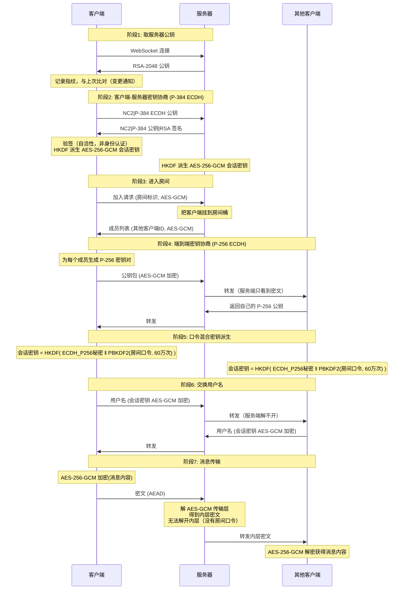

# NodeCrypt

🌐 **[English README](README_EN.md)**

## 🚀 部署说明

### 一键部署到 Cloudflare Workers

点击下方按钮即可一键部署到 Cloudflare Workers：
[](https://deploy.workers.cloudflare.com/?url=https://github.com/shuaiplus/nodecrypt)

- 构建命令：npm run build
- 部署命令：npm run deploy

### 关于自动同步上游（重要）

`.github/workflows/sync-upstream.yml` 已改为**只能手动触发**。原配置是每天凌晨自动 merge 上游并推送，而本项目的端到端加密全部在客户端 JS 里——**那段 JS 就是密钥处理逻辑**，自动合并意味着上游的一行改动会未经审阅直接进入你的部署。同步上游时请人工 review diff，尤其是 `client/js/` 下的加密代码。


## 📝 项目简介

NodeCrypt 是一个端到端加密的匿名聊天系统。所有加解密都在客户端本地完成，服务器只做密文中转，不保存任何消息历史，也无法解密消息内容。

需要说清楚一点：**保护消息内容的是房间口令，不是服务器公钥。** 房间口令作为密钥派生因子参与端到端密钥计算，服务器和中继都不掌握它——所以即使中继完全落入攻击者手里，也解不开消息内容。但它**不能**防御「攻击者能修改你加载的客户端 JS」这类情形，详见 [已知限制](#-已知限制)。

### 系统架构
- **前端**：ES6+ 模块化 JavaScript，无框架依赖
- **后端**：Cloudflare Workers + Durable Objects
- **通信**：WebSocket 实时双向通信
- **构建**：Vite 现代化构建工具

## 🔐 零知识架构设计

### 核心原则
- **服务器盲转**：服务器永远无法解密消息内容，仅负责加密数据中转
- **无数据库存储**：系统不使用任何持久化存储，所有数据仅在内存中临时存在
- **端到端加密**：消息从发送方到接收方全程加密，中间任何环节都无法解密
- **前向安全性**：即使密钥泄露，也无法解密历史消息，因为根本就没有历史消息
- **匿名通信**：用户无需注册真实身份，支持临时匿名聊天
- **多样体验**：和批量发送图片和文件，可选择主题和语言。

### 隐私保护机制

- **实时成员提醒**：房间在线列表完全透明，内任何人加入或离开都会实时通知所有成员，
- **无历史消息**：新加入的用户无法看到任何历史聊天记录
- **私聊加密**：点击用户头像可发起端到端加密的私密对话，房间内其他成员完全无法看到私聊内容

### 房间密码机制

房间密码作为**密钥派生因子**参与端到端密钥计算：

```
PBKDF2-SHA256(房间密码, salt = "nodecrypt-v2|pw|" + 房间名, 600000 次)  ─┐
                                                                        ├─ HKDF-SHA256 ─→ AES-256-GCM 会话密钥
ECDH P-256(自己私钥, 对方公钥)  ────────────────────────────────────────┘
```

两个因子**缺一不可**：只有 ECDH 秘密（中继拿得到）或只有口令（中继不知道）都算不出会话密钥。所以中继即便完全冒充服务器也算不出任何会话密钥。

- **密码错误隔离**：不同密码的房间无法解密彼此的消息
- **服务器盲区**：服务器永远无法获知房间密码

### 安全层次说明

#### 第一层：服务器密钥（提供什么 / 不提供什么）
- 服务器生成 RSA-2048 密钥对，每 24 小时轮换
- 客户端验签，确认「服务器给出的 ECDH 公钥」与「公布的 RSA 公钥」出自同一方
- 客户端会显示并记录服务器公钥指纹，指纹与上次不同时明确提示

**这一层不防中间人。** 上面的验签只是**自洽性校验**：它证明「持有该 RSA 私钥的人同时也持有那把 ECDH 私钥」，而 RSA 公钥本身是通过同一条未认证的通道发过来的，没有任何东西可以证明它属于「真正的服务器」。指纹记录（TOFU）也只是一种**变更通知**——初次连接的指纹本身就未认证，它只能告诉你「换了」，不能证明「换成了对的」。

#### 第二层：ECDH P-384（客户端 ↔ 服务器）
- 每个客户端与服务器之间独立协商密钥，经 HKDF-SHA256 派生
- 用 AES-256-**GCM** 保护控制消息（房间标识、成员列表）
- 作用范围：只保护这些控制信息不被**被动**窃听者看到

#### 第三层：端到端加密（客户端 ↔ 客户端）—— 真正保护消息内容的一层
- 每个对端独立协商的 ECDH P-256 密钥对
- 会话密钥 = HKDF(ECDH 秘密 ‖ PBKDF2(房间口令))
- 用 AES-256-**GCM**（AEAD）加解密，自带完整性校验
- **这一层即使中继被完全控制也解不开**，因为中继没有房间口令

#### 关于密钥派生与完整性
- 所有对称加密都是 AEAD（AES-256-GCM），密文被改动一个比特就会被拒绝——这是旧版本没有的能力
- 房间口令经 PBKDF2-SHA256 迭代 600,000 次派生，而不是一次 SHA-256
- 全部密码学原语来自浏览器原生 Web Crypto API，不依赖任何第三方加密库

## 🔄 完整加密流程详解




## 🛠️ 技术实现

全部密码学原语来自浏览器原生 **Web Crypto API**，不依赖任何第三方加密库：

| 用途 | 算法 |
|---|---|
| 对称加密（全部） | AES-256-GCM（AEAD，自带完整性校验） |
| 客户端↔服务器密钥协商 | ECDH P-384 |
| 客户端↔客户端密钥协商 | ECDH P-256 |
| 房间口令派生 | PBKDF2-SHA256，600,000 次迭代 |
| 会话密钥派生 | HKDF-SHA256 |
| 服务器签名 | RSASSA-PKCS1-v1_5 / RSA-2048 + SHA-256 |
| 房间标识 | SHA-256 |

第三方加密库（原版本使用的 `elliptic`、`aes-js`、`js-chacha20`、`js-sha256`）已全部移除。

## 🧪 测试与自行验证

### 自动化测试

```bash
# 1) 加密层互操作测试（不需要起服务，纯函数级）
#    验证客户端 aead.js 与服务端 utils.js 能互相解开，
#    并覆盖篡改、错误口令、错误房间等攻击面
node tests/p0-interop.test.mjs

# 2) 端到端测试（需要另开终端先跑起本地服务）
npx wrangler dev --port 8787
node tests/e2e-worker.test.mjs
```

`tests/e2e-worker.test.mjs` 同时是一份**协议一致性参考实现**：它不 import `NodeCrypt.js`，而是照协议独立写了一遍。两边对不上就说明有一方写错了。

### 手动验证

- **网络流量**：浏览器的开发者工具 → Network → WS，可以看到所有 WebSocket 帧都是不可读密文
- **公钥指纹**：客户端控制台会打印服务器公钥指纹；指纹变化时会给出明确提示
- **篡改检测**：用开发者工具手工改动任意一个密文字节，接收端会解密失败而不是解出乱码

### 代码审计
所有加密相关代码开源，使用标准密码学算法，欢迎安全研究者独立审计。加密实现集中在 `client/js/aead.js`（约 250 行）和 `worker/utils.js`，便于审查。

## ⚠️ 已知限制

请在使用前理解以下几点，它们决定了本项目的安全边界在哪里：

1. **不防「客户端被替换」**
   端到端加密的全部实现都在客户端 JS 里（`client/js/aead.js`）。如果攻击者能篡改你加载的这份 JS，那么再强的密码学也没有意义——加了后门的那份代码会把密钥直接送出去。**只从你信任的部署加载客户端。**

2. **不防主动中间人**
   服务器公钥没有任何认证机制（见「第一层」说明）。指纹记录只是变更通知。真正拦住中间人的是房间口令。

3. **房间口令的强度 = 端到端加密的实际强度**
   口令经 PBKDF2 迭代 60 万次，可以抵抗离线爆破，但**弱口令仍然会被字典攻击**。请使用足够长、足够随机的口令。

4. **房间名会泄漏给服务器**
   服务端用 `SHA-256(房间名)` 作为房间桶标识，它能看到这个值。房间名本身熵很低，不要用敏感信息当房间名。

5. **没有历史消息 = 没有离线送达**
   所有数据只在内存中，不落任何存储。代价是：对端不在线就收不到，刷新页面一切归零。

## ⚠️ 安全建议

- **使用强随机房间口令**：这是端到端加密的信任根，建议用密码管理器生成
- **口令保密性**：口令一旦泄露，该房间的通信内容就可能被解密
- **用最新版现代浏览器**：确保 Web Crypto API 的安全性和性能
- **不要在不受自己控制的部署上传输敏感内容**

## 🤝 安全贡献

欢迎安全研究者报告漏洞和进行安全审计。严重安全问题将在24小时内修复。

## 📄 开源协议

本项目采用 ISC 开源协议。

## ⚠️ 免责声明

本项目仅供学习和技术研究使用，不得用于任何违法犯罪活动。使用者应遵守所在国家和地区的相关法律法规。项目作者不承担因使用本软件而产生的任何法律责任。请在合法合规的前提下使用本项目。

---
## Star History

[](https://star-history.dera.page/#shuaiplus/NodeCrypt&Timeline)

**NodeCrypt** - 真正的端到端加密通信 🔐

*"在数字时代，加密是保护隐私的最后一道防线"*
