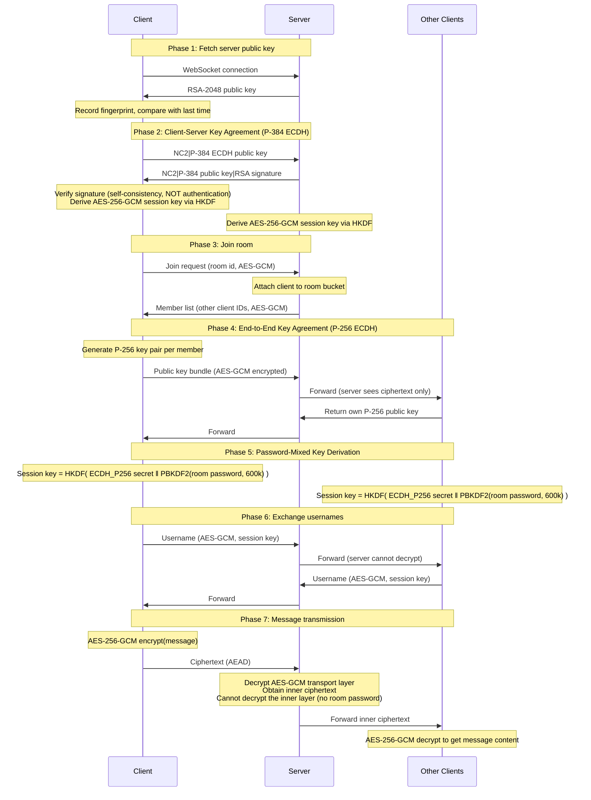

# NodeCrypt

🌐 **[中文版 README](README.md)**

## 🚀 Deployment Instructions

### Method 1: One-Click Deploy to Cloudflare Workers

Click the button below for one-click deployment to Cloudflare Workers:
[](https://deploy.workers.cloudflare.com/?url=https://github.com/shuaiplus/NodeCrypt)
> Note: This method creates a new project based on the main repository. Future updates to the main repository will not be automatically synchronized.

### Method 2: Auto-Sync Fork and Deploy (Recommended for Long-term Maintenance)
1. First, fork this project to your own GitHub account.
2. Open the Cloudflare Workers console, select "Import from GitHub," and choose your forked repository for deployment.
> **Do NOT enable automatic upstream sync together with automatic deployment.**
> The end-to-end encryption of this project lives entirely in client-side JS (`client/js/aead.js`, `client/js/NodeCrypt.js`) — that JS *is* the key-handling logic. If upstream is poisoned, compromised, or simply mis-edited, an automatic sync would push it straight into your deployment overnight with no one reviewing it. **Client-side crypto changes always need human eyes.**
> The bundled `sync-upstream.yml` workflow has therefore been changed to manual-only (`workflow_dispatch`): it reports the diff and never merges. Review upstream changes yourself, especially anything under `client/js/`.

### Method 3: Docker One-Click Deployment (Recommended for Self-hosting)

```bash
docker run -d --name nodecrypt -p 80:80 ghcr.io/shuaiplus/nodecrypt
```

Access http://localhost:80

### Method 4: Local Development Deployment
After cloning the project and installing dependencies, use `npm run dev` to start the development server.
Use `npm run deploy` to deploy to Cloudflare Workers.

## 📝 Project Introduction

NodeCrypt is a truly end-to-end encrypted chat system that implements a complete zero-knowledge architecture. The entire system design ensures that servers, network intermediaries, and even system administrators cannot access any plaintext message content. All encryption and decryption operations are performed locally on the client side, with the server serving only as a blind relay for encrypted data.

### System Architecture
- **Frontend**: ES6+ modular JavaScript, no framework dependencies
- **Backend**: Cloudflare Workers + Durable Objects
- **Communication**: Real-time bidirectional WebSocket communication
- **Build**: Vite modern build tool

## 🔐 Zero-Knowledge Architecture Design

### Core Principles
- **Server Blind Relay**: The server can never decrypt message content, only responsible for encrypted data relay
- **No Database Storage**: The system does not use any persistent storage; all data exists only temporarily in memory
- **End-to-End Encryption**: Messages are encrypted from sender to receiver throughout the entire process; no intermediary can decrypt them
- **Forward Secrecy**: Even if keys are compromised, historical messages cannot be decrypted because there are no historical messages at all
- **Anonymous Communication**: Users do not need to register real identities; supports temporary anonymous chat
- **Rich Experience**: Support for sending images and files, with optional themes and languages

### Privacy Protection Mechanisms

- **Real-time Member Notifications**: The room online list is completely transparent; any member joining or leaving will notify all members in real-time
- **No Historical Messages**: Newly joined users cannot see any historical chat records
- **Private Chat Encryption**: Clicking on a user's avatar can initiate end-to-end encrypted private conversations that are completely invisible to other room members

### Room Password Mechanism

Room passwords serve as **key derivation factors** in end-to-end key computation:

```
PBKDF2-SHA256(room password, salt = "nodecrypt-v2|pw|" + room name, 600000 iterations)  ─┐
                                                                                         ├─ HKDF-SHA256 ─→ AES-256-GCM session key
ECDH P-256(own private key, peer's public key)  ─────────────────────────────────────────┘
```

**Both factors are required.** Neither the ECDH secret alone (the relay can obtain it) nor the password alone (the relay does not know it) is sufficient. So even a fully malicious relay cannot derive any session key.

- **Password Error Isolation**: Rooms with different passwords cannot decrypt each other's messages
- **Server Blind Spot**: The server can never know the room password

### Security Layers

#### Layer 1: Server Key (what it does and does NOT provide)
- Server generates an RSA-2048 key pair, rotated every 24 hours
- The client verifies the signature, confirming that the ECDH public key and the published RSA public key come from the same party
- The client displays and records the server public key fingerprint, and reports clearly when it changes

**This layer does NOT prevent man-in-the-middle attacks.** The signature check above is only a **self-consistency check**: it proves that whoever holds the RSA private key also holds that ECDH private key. But the RSA public key itself arrives over the same unauthenticated channel, and nothing proves it belongs to the real server. Fingerprint pinning (TOFU) is likewise only a **change notification** — the first-seen fingerprint is itself unauthenticated, so it can only tell you *that* the key changed, never *that it changed to the right one*.

#### Layer 2: ECDH P-384 (Client ↔ Server)
- Independent key agreement between each client and the server, derived via HKDF-SHA256
- Control messages (room id, member list) protected with AES-256-**GCM**
- Scope: protects this control data from **passive** eavesdroppers only

#### Layer 3: End-to-End Encryption (Client ↔ Client) — the layer that actually protects content
- A separately negotiated ECDH P-256 key pair per peer
- Session key = HKDF(ECDH secret ‖ PBKDF2(room password))
- Encrypted with AES-256-**GCM** (AEAD), with built-in integrity verification
- **This layer cannot be broken even by a fully controlled relay**, because the relay does not know the room password

#### Key Derivation and Integrity
- All symmetric encryption is AEAD (AES-256-GCM): flipping a single bit of ciphertext is rejected — something the previous version could not do
- The room password goes through 600,000 PBKDF2-SHA256 iterations instead of a single SHA-256
- All cryptographic primitives come from the browser-native Web Crypto API; no third-party crypto libraries

## 🔄 Complete Encryption Process



## 🛠️ Technical Implementation

All cryptographic primitives come from the browser-native **Web Crypto API**. No third-party crypto libraries.

| Purpose | Algorithm |
|---|---|
| Symmetric encryption (all of it) | AES-256-GCM (AEAD, built-in integrity) |
| Client ↔ Server key agreement | ECDH P-384 |
| Client ↔ Client key agreement | ECDH P-256 |
| Room password derivation | PBKDF2-SHA256, 600,000 iterations |
| Session key derivation | HKDF-SHA256 |
| Server signature | RSASSA-PKCS1-v1_5 / RSA-2048 + SHA-256 |
| Room identifier | SHA-256 |

The third-party crypto libraries used by the original version (`elliptic`, `aes-js`, `js-chacha20`, `js-sha256`) have all been removed.

## ⚠️ Known Limitations

1. **Does not defend against a replaced client**
   The entire end-to-end implementation lives in client-side JS (`client/js/aead.js`). If an attacker can tamper with that JS, no amount of cryptography helps — the backdoored copy will simply hand over the keys. **Only load the client from a deployment you trust.**

2. **Does not defend against an active man-in-the-middle**
   The server public key has no authentication mechanism (see Layer 1). Fingerprint pinning is a change notification only. What actually stops a MITM is the room password.

3. **Room password strength = effective end-to-end strength**
   PBKDF2 with 600,000 iterations resists offline brute force, but **weak passwords still fall to dictionary attacks**. Use a long, random password.

4. **Room names leak to the server**
   The server uses `SHA-256(room name)` as the room bucket identifier and can see it. Room names have low entropy — do not put sensitive information in them.

5. **No history means no offline delivery**
   Everything lives in memory and nothing is written to storage. The trade-off: if the peer is offline the message is simply not delivered, and a page reload loses everything.

## 🧪 Tests

```bash
# 1) Crypto interop test (no server needed)
node tests/p0-interop.test.mjs

# 2) End-to-end test (start the local server first in another terminal)
npx wrangler dev --port 8787
node tests/e2e-worker.test.mjs
```

`tests/e2e-worker.test.mjs` doubles as a **protocol conformance reference implementation**: it does not import `NodeCrypt.js` but re-implements the protocol independently, so a mismatch means one of the two is wrong.

## 🔬 Security Verification

### Encryption Process Verification
Users can observe the complete encryption and decryption process through browser developer tools to verify that messages are indeed encrypted during transmission.

### Network Traffic Analysis
Network packet capture tools can verify that all WebSocket transmitted data is unreadable encrypted content.

### Code Security Audit
All encryption-related code is completely open source, using standard cryptographic algorithms. Security researchers are welcome to conduct independent audits.

## ⚠️ Security Recommendations

- **Use Strong Room Passwords**: Room passwords directly affect end-to-end encryption strength; complex passwords are recommended
- **Password Confidentiality**: If a room password is leaked, all communication content in that room may be decrypted
- **Use Latest Modern Browsers**: Ensure security and performance of cryptographic APIs

## 🤝 Security Contributions

Security researchers are welcome to report vulnerabilities and conduct security audits. Critical security issues will be fixed within 24 hours.

## 📄 Open Source License

This project uses the ISC open source license.

## ⚠️ Disclaimer

This project is for educational and technical research purposes only and must not be used for any illegal or criminal activities. Users should comply with the relevant laws and regulations of their country and region. The project author assumes no legal responsibility for any consequences arising from the use of this software. Please use this project legally and compliantly.

---

**NodeCrypt** - True End-to-End Encrypted Communication 🔐

*"In the digital age, encryption is the last line of defense for privacy"*
